# 1. Para qué sirve esta aplicación

La aplicación **Planificación Contable** ordena el trabajo del equipo contable de la Hacienda. Responde, cada día, tres preguntas:

1. **¿Qué tengo que hacer hoy?** Cada persona ve sus tareas, ordenadas por urgencia.
2. **¿Cómo va el cierre del mes?** La Gerente y la Jefa ven el avance, lo que está atrasado y quién está sobrecargado.
3. **¿Quién hizo qué, y a tiempo?** Cada tarea que se marca queda con su fecha, hora y persona, y el cumplimiento se calcula solo.

Cada mes, la aplicación genera las tareas del cierre desde la **planificación vigente** (el listado de procesos, tareas y subtareas con su responsable, quién las revisa y el día hábil en que vencen). Las personas las van marcando como hechas; quien revisa las aprueba o las devuelve.

> **Importante.** La aplicación no reemplaza a Odoo ni hace la contabilidad. Es el tablero de control del trabajo: dice qué se debe hacer, quién lo hace y si se hizo a tiempo.

Las pantallas de este manual usan **datos de ejemplo** (personas y cifras de prueba, con fecha simulada lunes 09-11-2026). Lo que verás en la aplicación real tendrá los nombres y números reales del equipo.

## 1.1 Quién puede hacer qué

Cada persona tiene un **perfil**, que decide lo que ve y lo que puede hacer. El menú de la izquierda solo muestra lo que tu perfil permite.

| Perfil | Qué hace | Qué ve en el menú |
|---|---|---|
| **Gerente** | Ejecuta y revisa tareas, abre meses, administra tareas, procesos y usuarios | Todo |
| **Jefatura** | Ejecuta y revisa tareas, edita tareas y procesos | Todo, menos «Abrir mes» y «Usuarios» |
| **Colaborador** | Ejecuta sus tareas, comenta, registra horas | Informes (menos la Matriz), Planificación (solo lectura) y Check List |
| **Solo lectura** | Solo consulta; no marca tareas | Igual que Colaborador, sin poder marcar |
| **Administrador del sistema** | Abre meses y administra usuarios; no ejecuta tareas | Informes, Planificación, Check List (solo consulta), Abrir mes y Usuarios |

## 1.2 Palabras que se repiten

| Palabra | Qué significa |
|---|---|
| **Cierre** | El cierre contable mensual. Va del día hábil 1 al día hábil 10 del mes siguiente. |
| **DH o «Día hábil»** | Día de trabajo (lunes a viernes, sin feriados). «Día 4» = cuarto día hábil del mes. |
| **DH00** | El último día hábil del mes anterior. |
| **Día 8, 9 y 10** | Día 8: reportes listos (en la tarde). Día 9: entrega al Gerente General. Día 10: informes al Directorio. |
| **Tarea / subtarea** | La tarea es el grupo (por ejemplo «Preparación del cierre»); la subtarea es la acción concreta que alguien marca como hecha. |
| **Código** | Cada subtarea tiene un código como `02-VEN.01.003`: orden del proceso, sigla del proceso, tarea y subtarea. |
| **Responsable (ejecuta)** | La persona o el cargo que hace la tarea. |
| **Revisa** | La persona que aprueba lo que otro hizo. Nunca revisa quien hizo la tarea. |
| **Cumplimiento a tiempo** | Tareas marcadas hechas en o antes de su fecha límite, dividido por las tareas que ya vencieron. Una tarea hecha tarde nunca cuenta como a tiempo. La meta es **95 %**. |
| **Estimado** | Horas o minutos que se calcularon para la tarea; las horas reales las anota quien la hace. |

## 1.3 Los estados de una tarea

| Estado | Qué significa |
|---|---|
| **Pendiente** | Aún no se hace. |
| **Hecha** | La persona ya la hizo y espera revisión (si la tarea tiene quien la revise). |
| **Revisada** | Quien revisa la aprobó. Terminó. |
| **Devuelta** | Quien revisa la devolvió con un comentario: hay que corregirla y marcarla de nuevo. |
| **Bloqueada** | La persona no puede avanzar (por ejemplo, falta información); queda anotado el motivo. |
| **No aplica** | La tarea no corresponde este mes (aprobado por quien revisa). |

Algunas tareas son **insumos que entregan áreas externas** (por ejemplo, la sala de ventas). En esas, la Jefa de Control no «hace» la tarea: registra **«Recibido»** cuando el insumo llega.

## 1.4 Colores y símbolos

| Marca | Significado |
|---|---|
| **⚠ Atrasada N días** (rojo) | La fecha límite ya pasó y la tarea sigue sin hacerse. |
| **● Vence hoy** (ámbar) | La fecha límite es hoy. |
| **↩ Devuelta** (rojo) | Quien revisa pidió correcciones. |
| **⛔ Bloqueada** (rojo) | La persona no puede avanzar; se lee el motivo debajo. |
| **Estimado** (etiqueta ámbar) | La cifra es una estimación, no un dato real. |

# 2. Cómo ingresar a la aplicación

## 2.1 Ingresar con usuario y contraseña

1. Abre la dirección de la aplicación que te entregó el administrador.
2. Escribe tu **usuario** (marcador 1) y tu **contraseña** (marcador 2).
3. Presiona **Ingresar** (marcador 3).

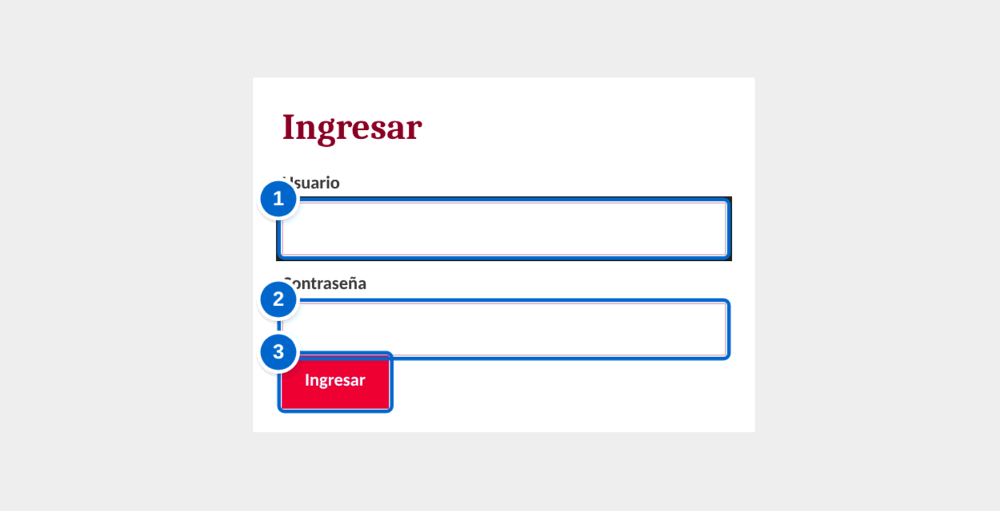{width=75%}

**Cuidado con los intentos.** Si te equivocas **cinco veces seguidas** con el mismo usuario, la cuenta se bloquea **15 minutos** (incluso con la clave correcta). Se desbloquea sola; espera y vuelve a intentar.

**Reglas de la contraseña:** mínimo **12 caracteres**. No la compartas ni la anotes en un lugar visible.

## 2.2 El código de seguridad (segundo paso)

Para la **Gerente AyF** y el **administrador del sistema**, el ingreso tiene un segundo paso obligatorio: un código de 6 números que cambia cada 30 segundos y muestra una aplicación en tu teléfono (Google Authenticator o Microsoft Authenticator).

**La primera vez**, la aplicación te muestra una clave de configuración. Se hace una sola vez:

1. En el teléfono, abre la aplicación de códigos y elige **«Agregar cuenta» → «Ingresar una clave de configuración»**.
2. Escribe la clave que aparece en pantalla. El tipo de clave es **basada en tiempo**.
3. Escribe en la pantalla el **código de 6 números** que ahora muestra el teléfono y presiona **Verificar**.

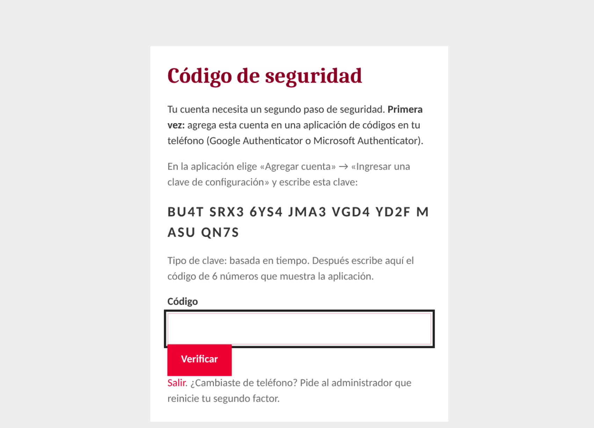{width=75%}

**Las veces siguientes** solo se pide el código:

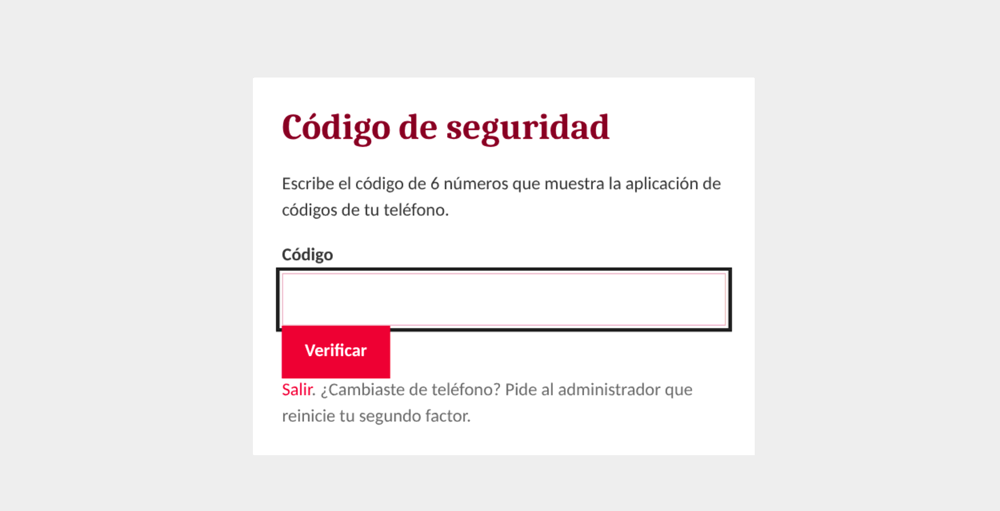{width=75%}

> **Si cambiaste de teléfono o lo perdiste**, usa «Salir» y pide al administrador que **reinicie tu segundo factor**: te mostrará una clave nueva.

## 2.3 Cambiar mi clave y salir

Abajo en el menú izquierdo hay dos opciones:

- **Cambiar mi clave**: escribe tu clave actual y la nueva dos veces (mínimo 12 caracteres).
- **Salir**: cierra tu sesión. Hazlo siempre que dejes el computador.

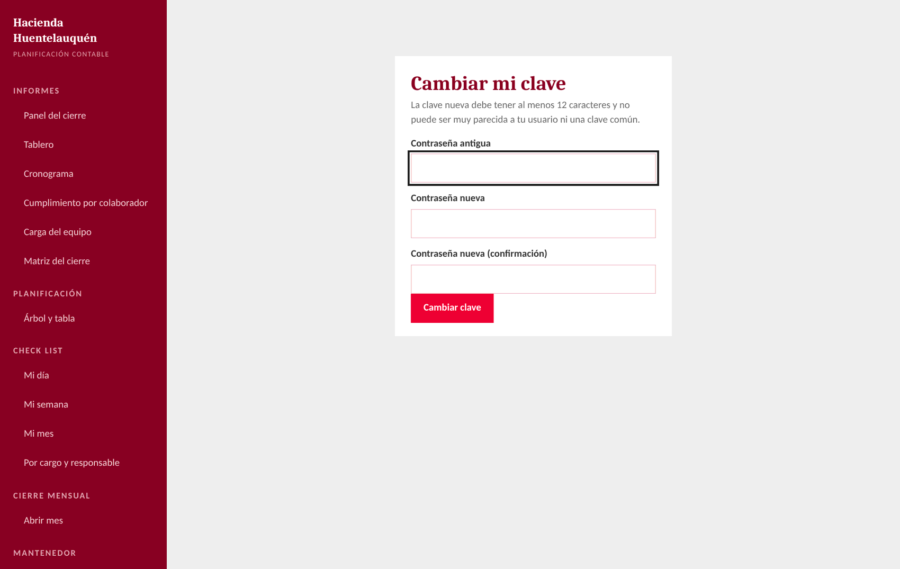{width=80%}

# 3. Recorrido por el menú

El menú izquierdo tiene cinco bloques. Los siguientes capítulos los recorren **en el mismo orden en que aparecen**: Informes, Planificación, Check List, Cierre mensual y Mantenedor.

Si solo vas a **ejecutar tareas** (tu trabajo diario), ve directo al capítulo 6 («Check List»), que es el que más usarás.

# 4. Informes

Los informes son para **mirar y decidir**: no se marca nada aquí. Todos tienen arriba los botones **‹ Mes anterior** y **Mes siguiente ›** para cambiar de mes.

## 4.1 Panel del cierre

Es la pantalla de la Gerente: muestra, de un vistazo, **cómo va el cierre del mes**.

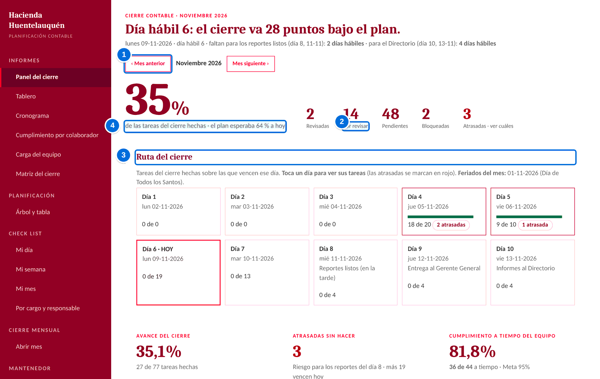{width=100%}

1. **Mes anterior / Mes siguiente**: cambia el mes que se está mirando.
2. **Contadores**: tareas *Revisadas*, *Por revisar*, *Pendientes*, *Bloqueadas* y *Atrasadas*. «Atrasadas» es un enlace que lleva a ver cuáles son.
3. **Ruta del cierre**: una tarjeta por cada día hábil del cierre (Día 1 al Día 10). Cada tarjeta dice cuántas tareas que vencían ese día ya están hechas («18 de 20») y cuántas están atrasadas. La tarjeta de **hoy** va resaltada. **Toca un día** para ver sus tareas.
4. **El titular y el porcentaje grande**: cuántas tareas del cierre están hechas **contra lo que el plan esperaba a esta fecha**. Si dice «va 28 puntos bajo el plan», el avance real está 28 puntos por debajo de lo planificado.

Más abajo hay tres tarjetas de resumen:

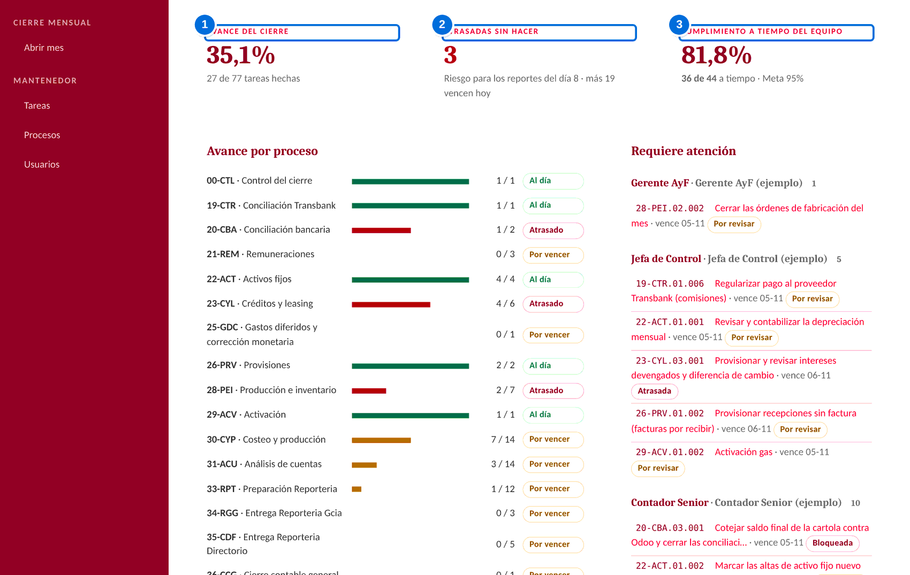{width=100%}

1. **Avance del cierre**: tareas hechas sobre el total del mes.
2. **Atrasadas sin hacer**: cuántas, y el riesgo para los reportes del día 8.
3. **Cumplimiento a tiempo del equipo**: el indicador principal contra la meta de 95 %.

## 4.2 Tablero

Muestra **todas las tareas abiertas del cierre como tarjetas**, ordenadas en columnas según su estado: *Pendiente*, *Bloqueada*, *Por revisar*, *Hecha o revisada* y *Devuelta*.

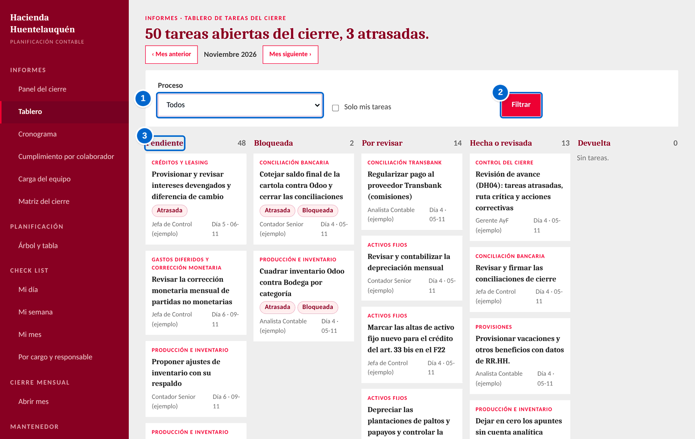{width=100%}

1. **Proceso**: elige un proceso para ver solo sus tareas («Todos» muestra todo). Hay también una casilla **«Solo mis tareas»**.
2. **Filtrar**: aplica el filtro.
3. **Columnas por estado**: cada tarjeta muestra el proceso, la tarea, quién la hace, el día del cierre y la fecha. Las atrasadas llevan una etiqueta roja.

## 4.3 Cronograma

Responde: **¿qué vence cada día, por proceso?** Es una tabla con los procesos en las filas y los días en las columnas; el número es la cantidad de tareas que vencen ese día.

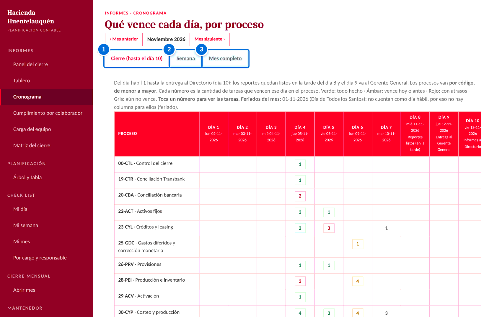{width=100%}

Elige la vista con las pestañas:

1. **Cierre (hasta el día 10)**: del día hábil 1 a la entrega al Directorio.
2. **Semana**: solo la semana elegida.
3. **Mes completo**: todos los días del mes.

**Colores de los números:** verde = todo hecho; ámbar = vence hoy o antes; rojo = con atrasos; gris = aún no vence. **Toca un número** para ver las tareas de ese proceso en ese día. Los feriados no tienen columna, porque no son día hábil.

## 4.4 Cumplimiento por colaborador

Mide **qué tan a tiempo trabaja cada persona**. No se usa para castigar: sirve para detectar dónde ayudar.

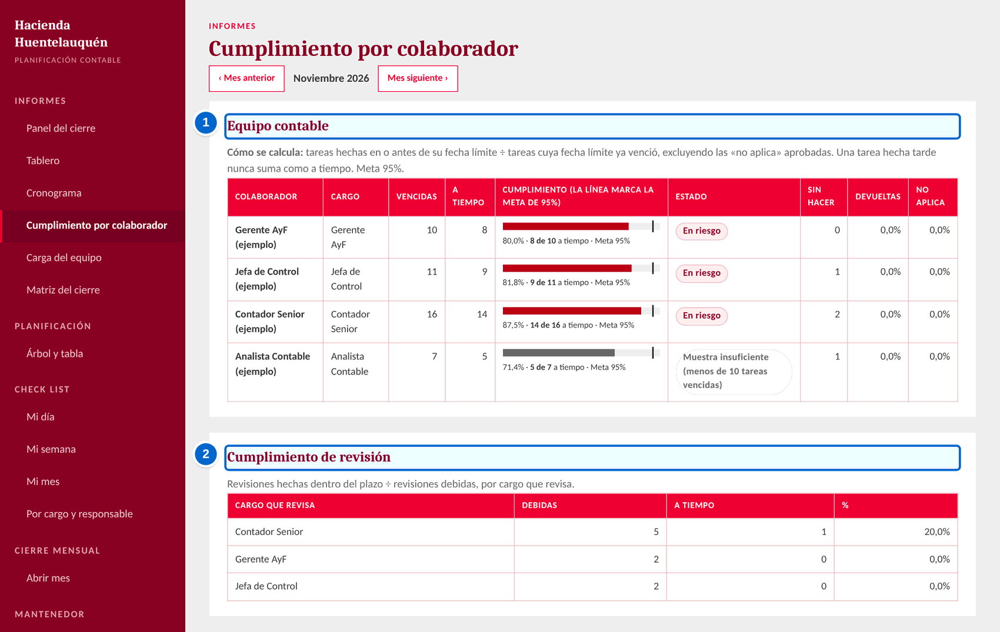{width=100%}

1. **Equipo contable**: por persona, cuántas tareas vencieron, cuántas se hicieron a tiempo y el porcentaje, con una línea que marca la meta de 95 %. Si una persona tiene **menos de 10 tareas vencidas** se avisa «Muestra insuficiente», porque con tan pocas tareas el porcentaje engaña. «Sin hacer» cuenta las atrasadas que siguen pendientes.
2. **Cumplimiento de revisión**: cuántas revisiones se debían y cuántas se hicieron dentro del plazo, por cargo que revisa.

Más abajo, **Insumos de responsables externos** muestra lo que la Jefa recibe de áreas externas (se mide aparte y no entra al cumplimiento de ninguna persona).

> **Cómo se calcula:** tareas hechas en o antes de su fecha límite ÷ tareas cuya fecha límite ya venció, sin contar las «no aplica» aprobadas.

## 4.5 Carga del equipo

Muestra **cuánto trabajo tiene cada persona** frente a su capacidad (160 horas al mes). Todas las cifras son **estimaciones**.

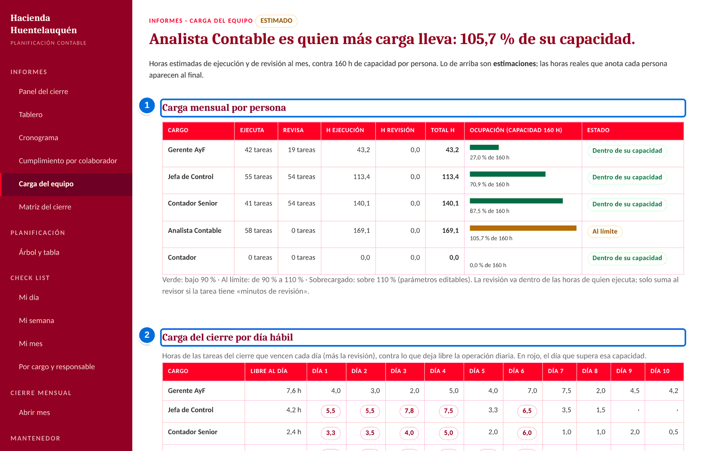{width=100%}

1. **Carga mensual por persona**: tareas que ejecuta y que revisa, horas de ejecución y revisión, y el porcentaje de ocupación. Verde: bajo 90 %; «Al límite»: de 90 % a 110 %; «Sobrecargado»: sobre 110 %.
2. **Carga del cierre por día hábil**: las horas que vencen cada día del cierre (más la revisión) contra lo que deja libre la operación diaria. **En rojo, el día que supera esa capacidad**.

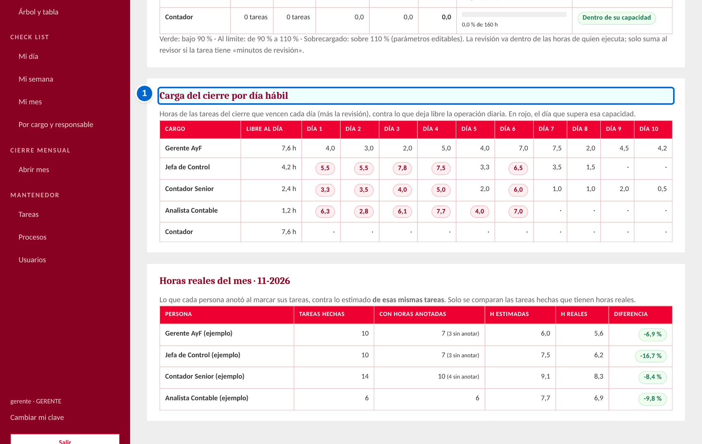{width=100%}

> **Para qué sirve:** si una persona aparece en rojo un día, hay que mover una tarea a otro día o a otra persona (esto se hace en el Mantenedor, capítulo 8).

## 4.6 Matriz del cierre (solo Gerente y Jefatura)

Es el **plan del cierre completo**: quién hace qué cada día, con un diagnóstico de control de gestión.

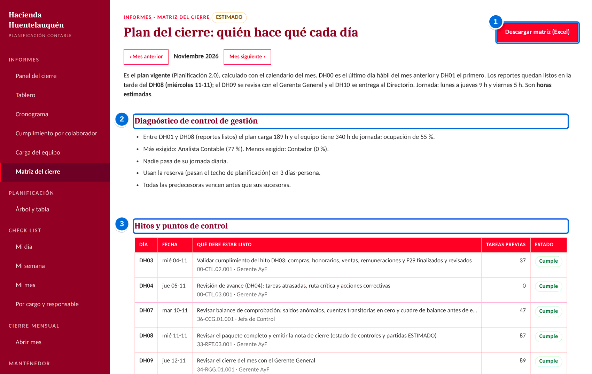{width=100%}

1. **Descargar matriz (Excel)**: baja la matriz a una planilla.
2. **Diagnóstico de control de gestión**: frases automáticas que resumen el plan: cuántas horas carga el plan hasta el día 8 frente a las horas de jornada, quién está más y menos exigido, si alguien pasa de su jornada diaria y si cada tarea previa vence antes que la siguiente.
3. **Hitos y puntos de control**: los puntos del cierre (por ejemplo DH03, DH04, DH07, DH08, DH09), qué debe estar listo, cuántas tareas previas tiene y si **«Cumple»**.

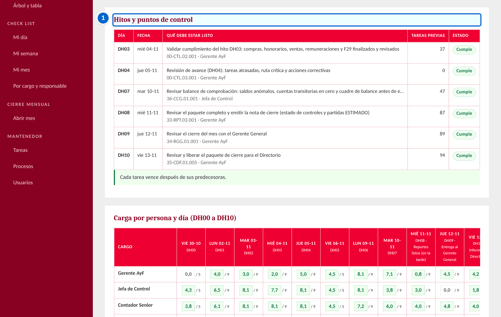{width=100%}

# 5. Planificación — Árbol y tabla

Es el **catálogo completo** de procesos, tareas y subtareas. Se puede mirar de dos maneras.

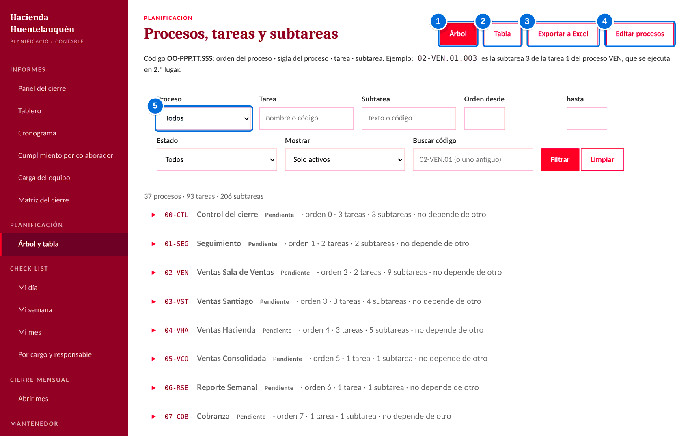{width=100%}

1. **Árbol**: cada proceso se despliega (flecha roja ▶) para mostrar sus tareas y subtareas.
2. **Tabla**: la misma información en una sola tabla.
3. **Exportar a Excel** (Gerente y Jefatura): baja lo que se está viendo.
4. **Editar procesos** (Gerente y Jefatura): lleva al Mantenedor de procesos.
5. **Filtros**: por proceso, tarea, subtarea, rango de orden, estado y código. Presiona **Filtrar** para aplicar o **Limpiar** para empezar de nuevo.

**Cómo leer el código `OO-PPP.TT.SSS`:** `OO` es el orden del proceso, `PPP` su sigla, `TT` la tarea y `SSS` la subtarea. Ejemplo: `02-VEN.01.003` es la subtarea 3 de la tarea 1 del proceso VEN, que se ejecuta en 2.º lugar.

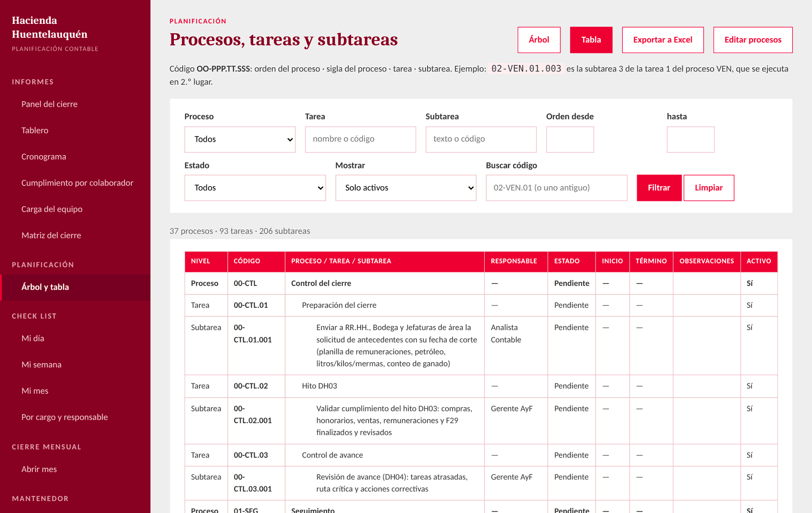{width=100%}

La tabla muestra el nivel (proceso, tarea o subtarea), el código, el responsable, el estado de planificación, las fechas de inicio y término, las observaciones y si está activa.

# 6. Check List — el trabajo del día a día

Este es el bloque que usa **cada persona del equipo** para ver y marcar sus tareas.

## 6.1 Mi día

Muestra **solo tus tareas**, separadas por urgencia. Es la primera pantalla que se abre al ingresar.

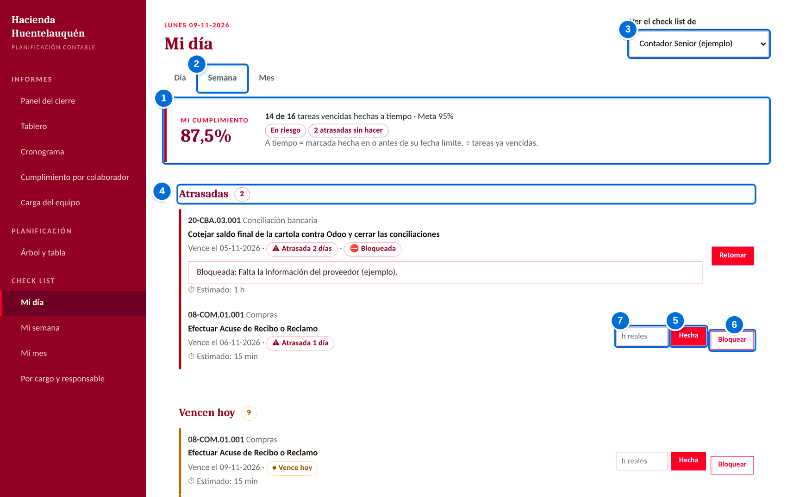{width=100%}

1. **Mi cumplimiento**: tu porcentaje de tareas vencidas hechas a tiempo, contra la meta de 95 %.
2. **Pestañas Día / Semana / Mes**: cambian entre tu vista de hoy, de la semana o del mes.
3. **Ver el check list de…**: eliges de quién ver las tareas. Puedes consultar las de otra persona, pero solo ella (o quien la reemplaza) puede marcarlas.
4. **Bloques por urgencia**, de arriba hacia abajo: **Atrasadas** (rojo), **Vencen hoy** (ámbar), **Por revisar**, **Por recibir** (solo la Jefa) y **Próximas**. Primero lo más urgente.
5. **Hecha**: marca la tarea como hecha.
6. **Bloquear**: la marca como bloqueada cuando no puedes avanzar (te pide el motivo).
7. **h reales**: opcional; escribe cuánto tardaste, con coma («1,5») o en horas y minutos («1:30»).

Cada tarea muestra su código y proceso, el texto de la tarea, la fecha de vencimiento, la etiqueta de urgencia y el tiempo estimado. **Si tocas el texto de la tarea, se abre su detalle** (sección 6.5).

### Cómo marcar una tarea como hecha

1. Busca la tarea en **Atrasadas** o **Vencen hoy**.
2. (Opcional) Escribe las horas que tardaste en el cuadro «h reales».
3. Presiona **Hecha**.
4. La tarea baja a «Hecha» y queda anotado quién la marcó y cuándo. Si tiene revisor, pasa a su lista de «Por revisar».

> **Una tarea marcada tarde nunca cuenta como a tiempo.** Por eso conviene marcarla el mismo día en que se hace.

### Cómo bloquear una tarea y retomarla

1. Presiona **Bloquear** y escribe el motivo («falta la información del proveedor»).
2. La tarea queda con la etiqueta **⛔ Bloqueada** y se ve el motivo para todo el equipo.
3. Cuando se resuelva, presiona **Retomar** y sigue el flujo normal.

### Cómo revisar el trabajo de otra persona

Si tu cargo **revisa** tareas, verás el bloque **Por revisar**:

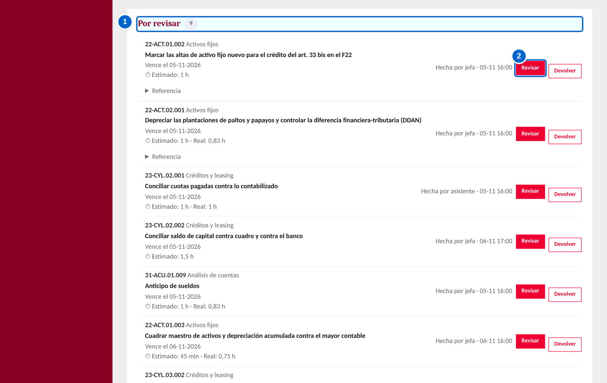{width=100%}

1. El bloque **Por revisar** (marcador 1) lista lo que otros ya hicieron y te toca aprobar.
2. Presiona **Revisar** (marcador 2) para aprobar la tarea. Pasa a «Revisada».
3. O presiona **Devolver** si hay que corregir. **Escribe el motivo**: es obligatorio. La tarea vuelve a la persona con la etiqueta **↩ Devuelta**.

> **Regla de control:** no puedes revisar una tarea que hiciste tú. Siempre revisa otra persona.

### Cómo recibir un insumo externo (Jefa de Control)

Algunas tareas son entregas de áreas externas (por ejemplo, las ventas de una sucursal). La Jefa las ve en **Por recibir** y presiona **Recibido** cuando el insumo llega:

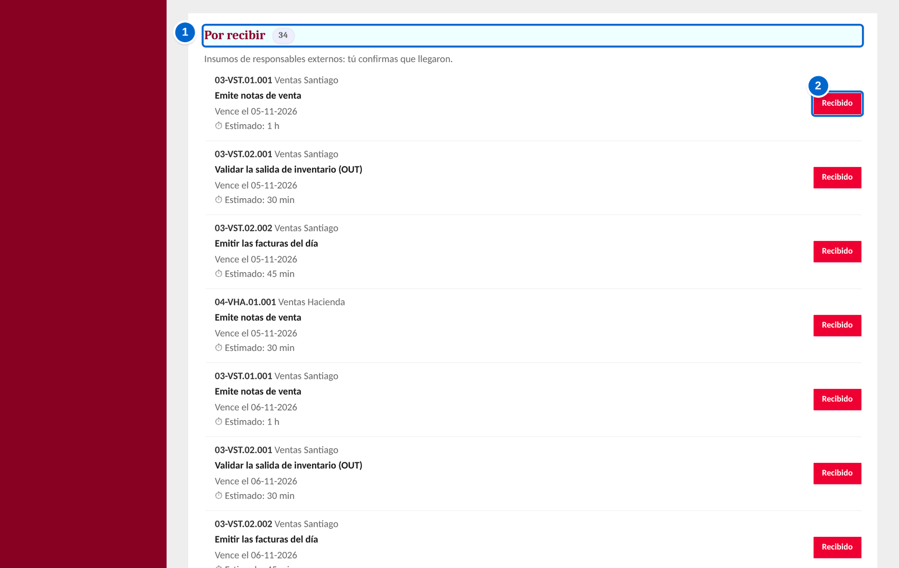{width=100%}

Estas entregas se miden aparte y no entran al cumplimiento de ninguna persona del equipo.

### Las próximas tareas

Al final de la pantalla, **Próximas** lista lo que vence en los siguientes días, para que te anticipes:

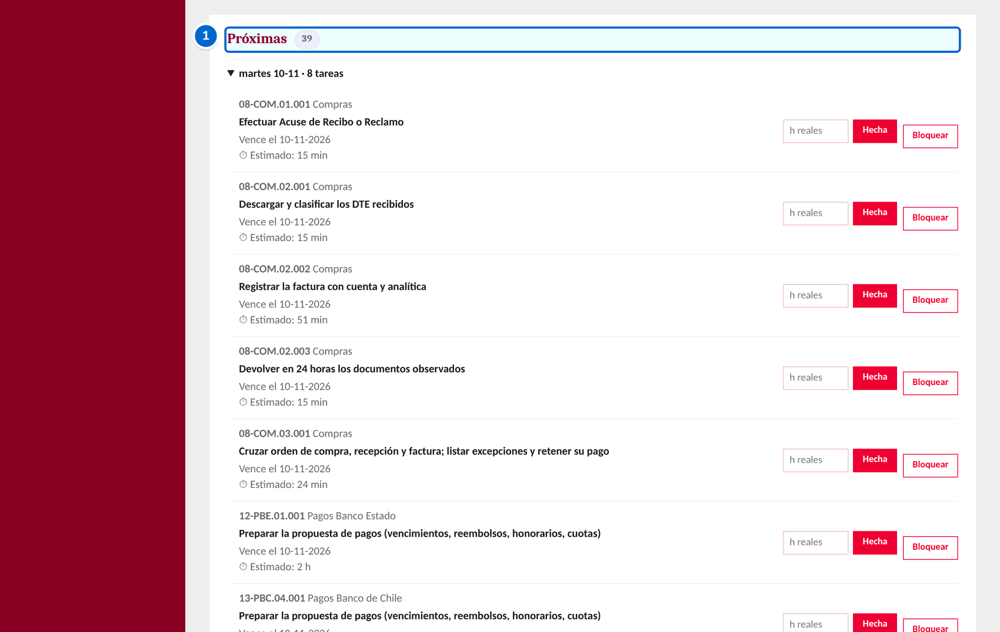{width=100%}

### Si la Gerente ve el check list de otra persona

Con el selector **«Ver el check list de»** (marcador 1) puedes elegir a quién mirar; la Gerente y la Jefa lo usan para seguir al equipo. Arriba se ve el cumplimiento de esa persona (marcador 2):

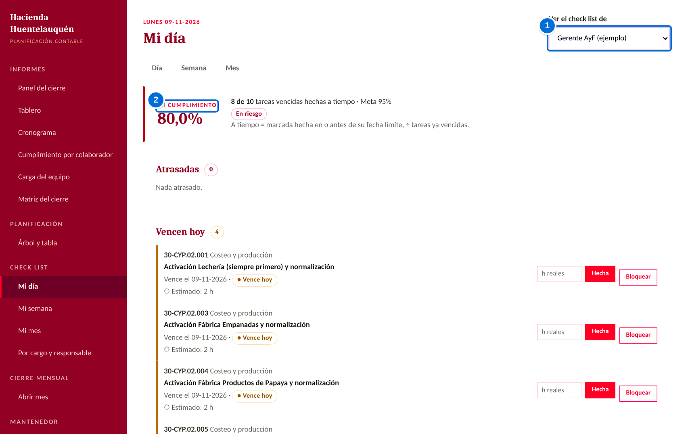{width=100%}

### Período de arranque («Por registrar»)

Durante las primeras semanas de uso de la aplicación (desde el **01-11-2026 hasta el 22-11-2026**), el equipo está anotando lo que ya hizo. En ese período **nada cuenta como atrasado**: lo que ya pasó de su fecha aparece en un bloque llamado **«Por registrar»**, con la fecha en que dejará de ser tolerado. Marca lo que ya hiciste. **Desde el lunes 23-11-2026**, lo que siga pendiente se ve como atrasado, igual que cualquier otra tarea.

## 6.2 Mi semana

Muestra tus tareas **día por día**, de lunes a viernes, con las horas de jornada de cada día (9 horas de lunes a jueves, 5 el viernes).

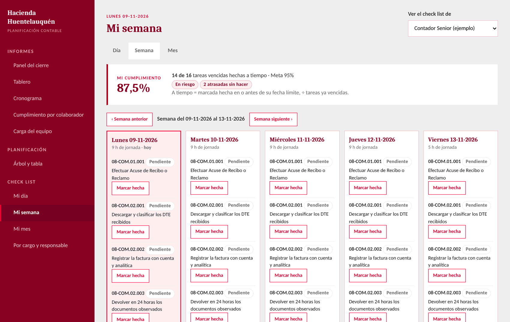{width=100%}

Arriba están tu cumplimiento y los botones **‹ Semana anterior / Semana siguiente ›**. Cada día lista sus tareas con el botón **Marcar hecha**. Sirve para repartir el trabajo y ver si alguna jornada está muy cargada.

## 6.3 Mi mes

Muestra **todas tus tareas del mes**. Arriba, la **Ruta del cierre**: una tarjeta por cada día hábil del cierre, con cuántas de *tus* tareas de ese día ya están hechas. Abajo, la tabla **Tareas del mes**, con la fecha de vencimiento, el código, el proceso, la tarea y su estado, y el botón para marcarla.

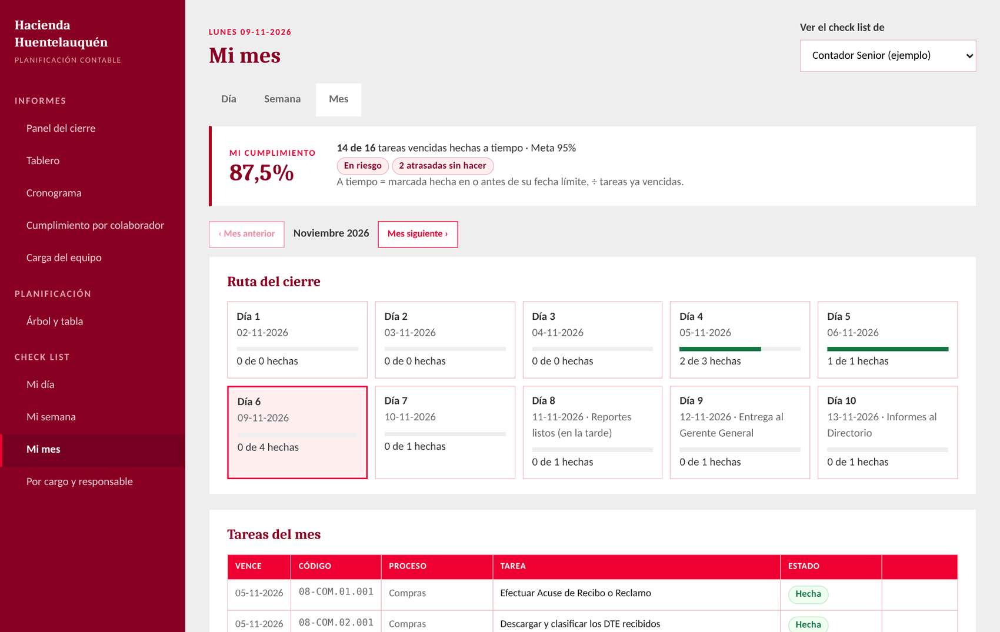{width=100%}

Es útil para revisar el panorama del mes completo y encontrar lo que quedó pendiente. También tiene los botones **‹ Mes anterior / Mes siguiente ›**.

## 6.4 Por cargo y responsable

Es el control de la Gerente y la Jefa: **quién es responsable de cada grupo de tareas y cómo van**.

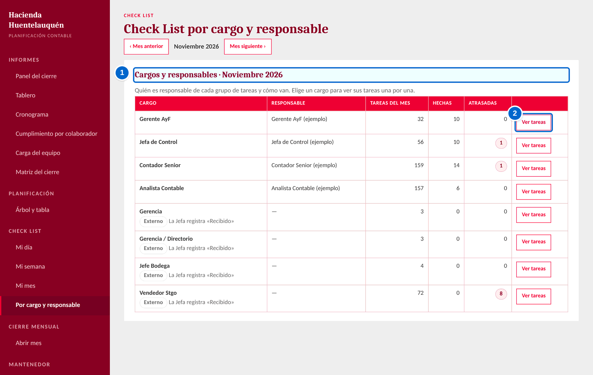{width=100%}

1. **Cargos y responsables**: para cada cargo, quién lo ejerce, cuántas tareas tiene en el mes, cuántas están hechas y cuántas atrasadas. Las áreas externas (Gerencia, Jefe de Bodega, Vendedor, etc.) aparecen aparte, con la nota «La Jefa registra Recibido».
2. **Ver tareas**: abre las tareas de ese cargo, una por una.

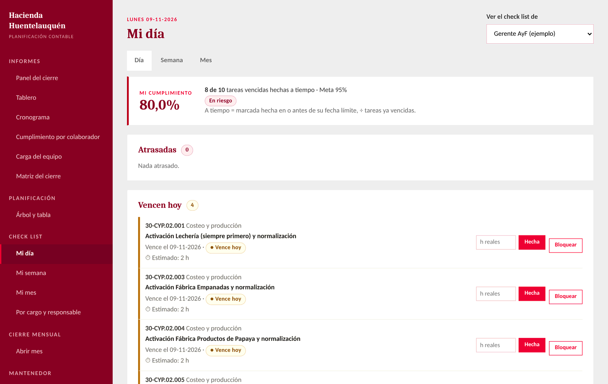{width=100%}

## 6.5 El detalle de una tarea

Al tocar una tarea se abre su **detalle**, con toda la información y las acciones.

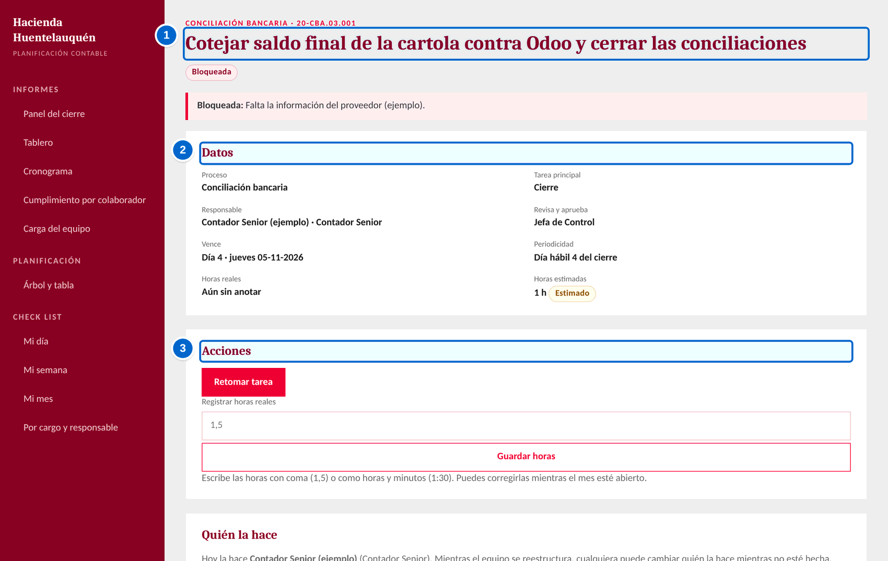{width=100%}

1. **Título**: el código, el proceso y el nombre de la tarea, con su estado y, si está bloqueada, el motivo.
2. **Datos**: proceso, tarea principal, **responsable**, **quién revisa y aprueba**, fecha de vencimiento, periodicidad, horas reales y horas estimadas.
3. **Acciones**: los botones que tu perfil permite en este momento (por ejemplo *Hecha*, *Bloquear*, *Retomar*, *Revisar*, *Devolver*) y el cuadro para **registrar horas reales**. Se pueden corregir mientras el mes esté abierto.

### Cambiar quién hace la tarea

Mientras el equipo se reestructura, **cualquier persona del equipo puede cambiar quién ejecuta una tarea que aún no está hecha**. Queda anotado en el historial.

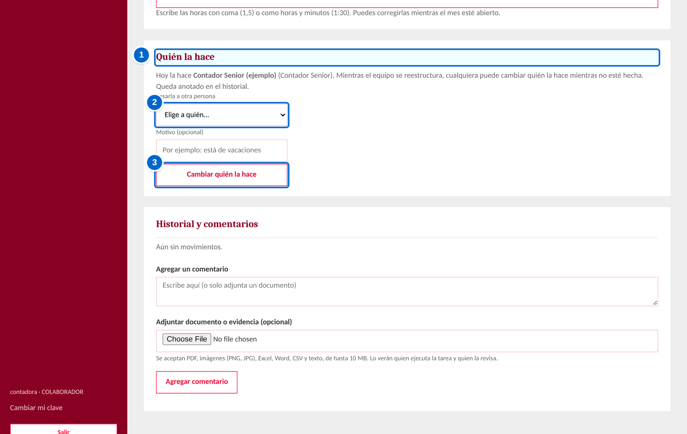{width=100%}

1. **Quién la hace**: muestra quién la hace hoy.
2. **Pasarla a otra persona**: elige a quién («Elige a quién…»). Solo aparecen personas del equipo que no sean quien ya la hace ni quien la revisa. Puedes escribir un motivo (opcional), por ejemplo «está de vacaciones».
3. **Cambiar quién la hace**: confirma el cambio. La tarea aparece desde ese momento en el check list de la otra persona.

> **Solo se puede cambiar mientras la tarea no esté hecha** y el mes siga abierto.

### Historial, comentarios y evidencias

Abajo del detalle está el **historial** de lo que pasó con la tarea (quién la marcó, cuándo, cambios de responsable, devoluciones) y un espacio para **comentar y adjuntar un documento**:

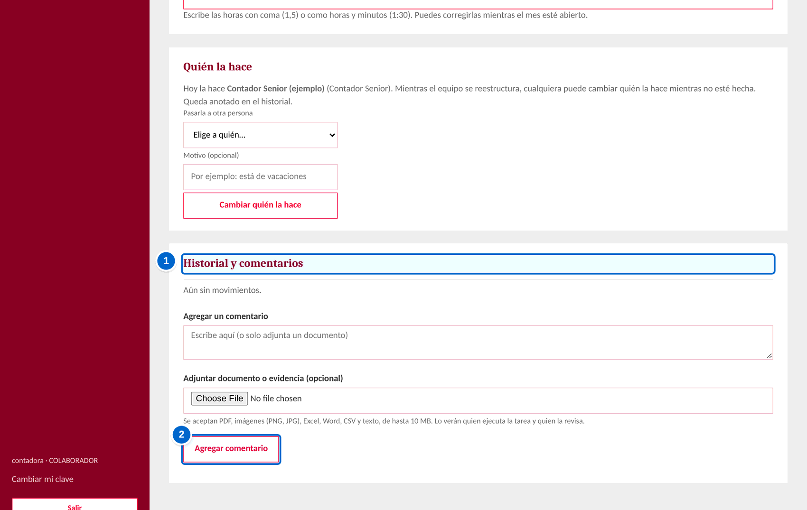{width=100%}

1. **Historial y comentarios**: todos los movimientos, en orden.
2. **Agregar comentario**: escribe un texto, adjunta un archivo o ambos. Se aceptan **PDF, imágenes (PNG, JPG), Excel, Word, CSV y texto, de hasta 10 MB**. Lo ven quien ejecuta la tarea y quien la revisa.

# 7. Cierre mensual — Abrir mes (Gerente y administrador)

Cada mes, la Gerente (o el administrador) **abre el mes** para que la aplicación genere las tareas del cierre. Son tres pasos, **en este orden**. Nada se genera hasta que se confirma.

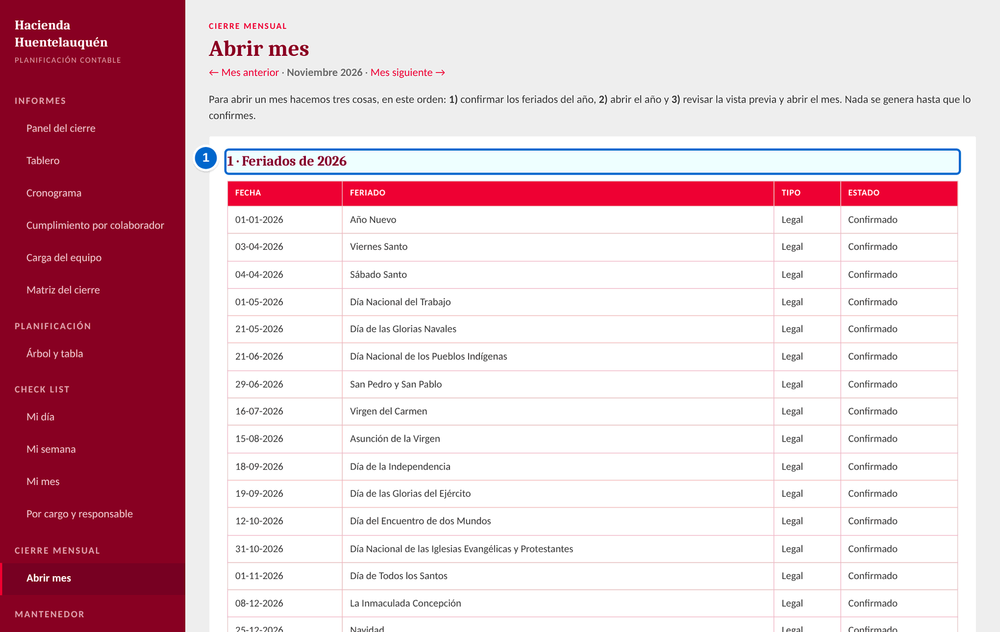{width=100%}

**Paso 1 — Confirmar los feriados del año.**

1. Revisa la lista de feriados del año (marcador 1). La aplicación trae los feriados legales; deben quedar en estado **Confirmado**.
2. Si hay un feriado decretado o regional que falta (marcador 2), agrégalo con **«Agregar un feriado decretado o regional»**.
3. Confirma los feriados. Los feriados deciden qué día es hábil, y por lo tanto cuándo vence cada tarea.

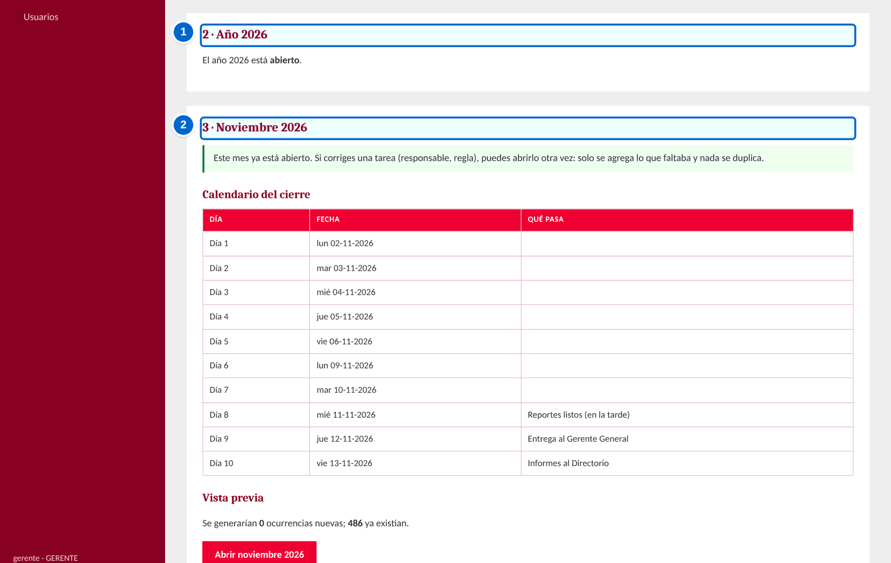{width=100%}

**Paso 2 — Abrir el año** (marcador 1). Solo se hace una vez al año, después de confirmar los feriados.

**Paso 3 — Abrir el mes** (marcador 2). Revisa la **vista previa** (cuántas tareas se generarán y si hay avisos) y confirma. Si alguna tarea no se puede generar (por ejemplo, no tiene responsable), aparece en **«Tareas que no se generan hasta corregirlas»**.

> **Si corriges una tarea después de abrir el mes**, puedes abrirlo otra vez: solo se agrega lo que faltaba y no se duplica nada.

Los feriados de 2027 y 2028 vienen **propuestos** por la aplicación; la Gerente debe revisarlos y confirmarlos antes de abrir esos años.

# 8. Mantenedor (Gerente y Jefatura)

El Mantenedor es donde se **cambia la planificación**: tareas, procesos y usuarios. Un cambio en una tarea **rige desde el próximo mes que se abra**; lo ya generado no se modifica.

## 8.1 Tareas

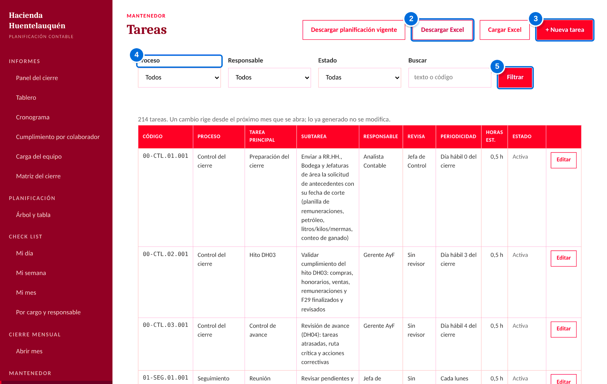{width=100%}

En la parte superior hay cuatro botones:

- **Descargar planificación vigente**: baja un Excel con el plan completo, listo para revisarlo, corregirlo y volver a cargarlo.
- **Descargar Excel**: baja la planilla de tareas, con una hoja «Instrucciones» que explica cada columna.
- **Cargar Excel** (marcador 2): sube la planilla corregida (ver más abajo).
- **+ Nueva tarea** (marcador 3): crea una tarea a mano.

Más abajo, los **filtros** (marcadores 4 y 5): por proceso, responsable, estado (activas, inactivas, «requieren revisión») y texto o código. Presiona **Filtrar**.

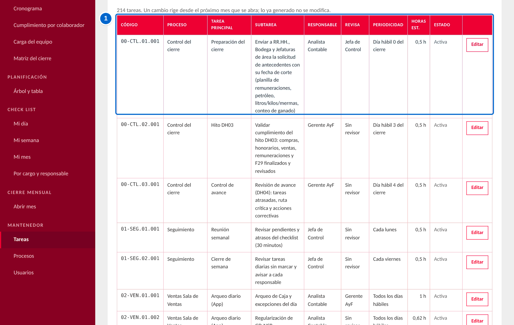{width=100%}

La lista muestra, por cada subtarea: código, proceso, tarea principal, subtarea, **responsable**, **quién revisa**, **periodicidad** (por ejemplo «Día hábil 4 del cierre»), horas estimadas y estado. El botón **Editar** abre su ficha.

### Editar una tarea

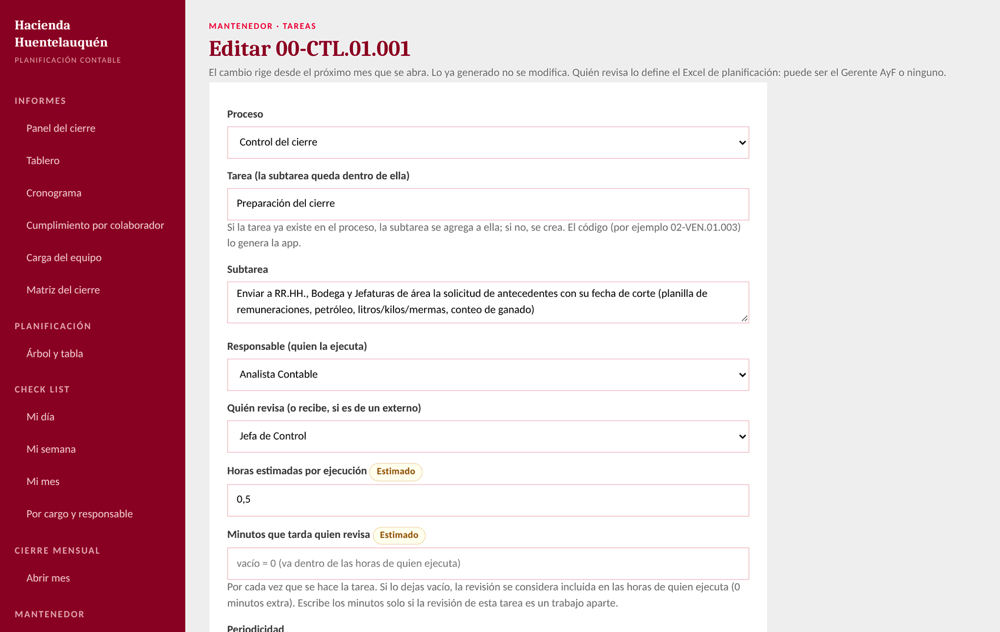{width=100%}

Los campos principales son:

- **Proceso, Tarea y Subtarea**: dónde vive y cómo se llama.
- **Responsable (quien la ejecuta)** y **Quién revisa**: se eligen de la lista de cargos. Si la tarea es de un externo, «quien revisa» es quien la recibe.
- **Horas estimadas por ejecución** y **minutos que tarda quien revisa** (opcional; por defecto la revisión va dentro de las horas de quien ejecuta).

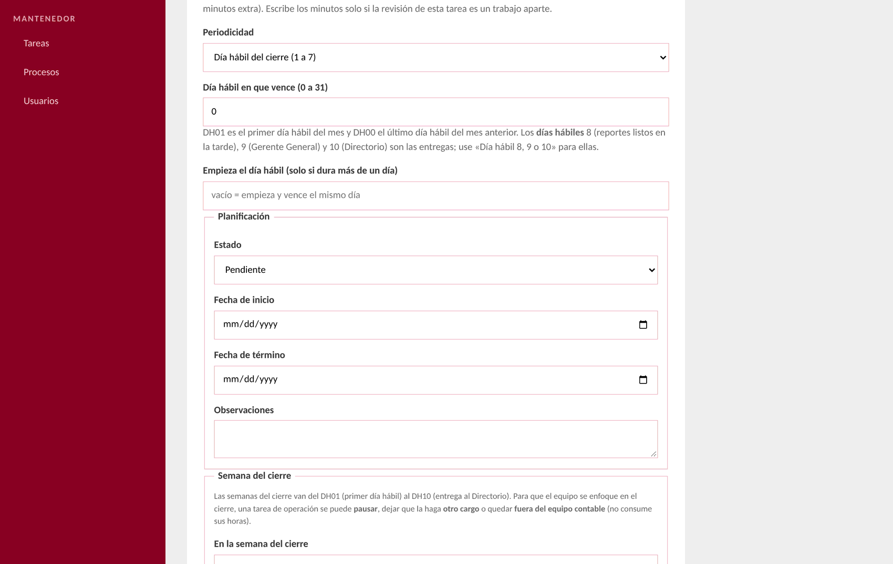{width=100%}

- **Periodicidad**: cada cuándo se repite. Las opciones más usadas son *Día hábil del cierre* (por ejemplo «día hábil en que vence: 4»), diaria, semanal, y ciertos meses del año.
- **Día hábil en que vence (0 a 31)**: DH0 es el último día hábil del mes anterior. Los días 8, 9 y 10 son los hitos de entrega.
- **Empieza el día hábil**: solo si la tarea dura más de un día.
- **Planificación**: estado, fechas de inicio y término y observaciones. Son para ordenar el trabajo y no cambian el cumplimiento del mes.
- **Semana del cierre**: cómo se comporta la tarea cuando el equipo está en el cierre (se puede dejar igual, pasar a otro cargo, pausar o quedar fuera del equipo contable).

Presiona **Guardar** para confirmar o **Cancelar** para salir sin cambios.

### Cargar una planificación desde Excel

Es la forma más rápida de hacer **muchos cambios a la vez**.

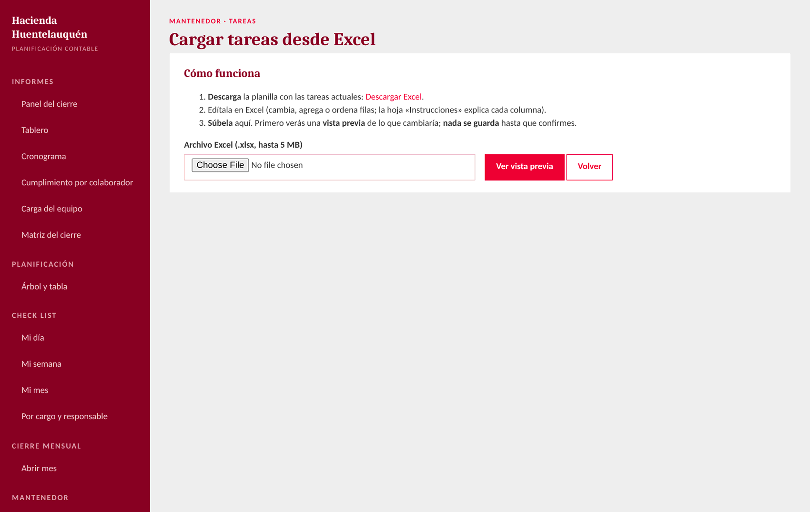{width=100%}

1. Descarga la planilla con las tareas actuales (**Descargar Excel** o **Descargar planificación vigente**).
2. Edítala en Excel: cambia, agrega o reordena filas. La hoja «Instrucciones» explica cada columna.
3. Súbela aquí (archivo `.xlsx`, hasta 5 MB) y presiona **Ver vista previa**.
4. La aplicación muestra **qué cambiaría**: tareas nuevas, modificadas y las que están en la aplicación pero no en el archivo (esas **no se borran**: se desactivan y dejan de generarse desde el próximo mes).
5. Si todo está bien, **confirma**. Hasta ese momento no se guarda nada.

> **Si el archivo trae errores**, la vista previa los lista. Corrige el Excel y súbelo de nuevo.

## 8.2 Procesos

Un **proceso** es un grupo de tareas (por ejemplo «Conciliación bancaria»). Aquí se ordenan y se les define qué proceso espera a cuál.

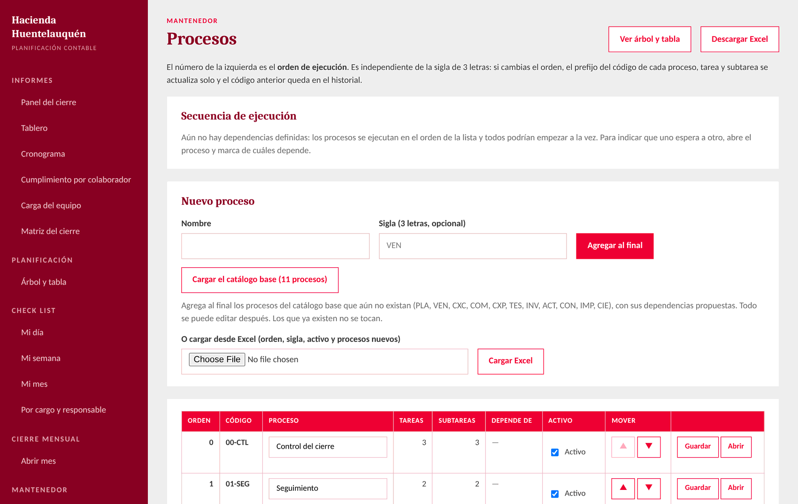{width=100%}

- **Orden de ejecución**: el número de la izquierda. Se cambia con las flechas **▲ ▼**. Si cambias el orden, el prefijo del código de cada proceso, tarea y subtarea se actualiza solo y el código anterior queda en el historial.
- **Nuevo proceso**: escribe el nombre (y, si quieres, una sigla de 3 letras) y presiona **Agregar al final**.
- **Cargar el catálogo base**: agrega los procesos estándar que aún no existan.
- **Cargar Excel**: orden, sigla, activo y procesos nuevos, desde una planilla.
- **Guardar / Abrir**: guarda el cambio de esa fila, o abre el proceso.

Al **abrir un proceso** se ve su detalle:

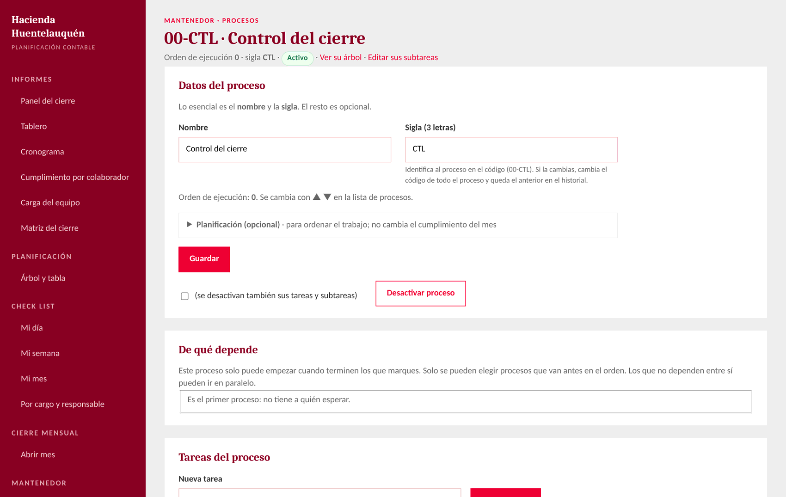{width=100%}

- **Datos del proceso**: nombre y sigla. «Desactivar proceso» también desactiva sus tareas y subtareas.
- **De qué depende**: marca qué procesos deben terminar antes de que este pueda empezar. Los que no dependen entre sí pueden ir en paralelo.
- **Tareas del proceso**: la lista de tareas y subtareas, y un cuadro para agregar una nueva.

## 8.3 Usuarios (Gerente y administrador)

Cada persona que usa la aplicación tiene un **usuario**, un **perfil** (qué puede hacer) y un **cargo** (qué tareas le corresponden).

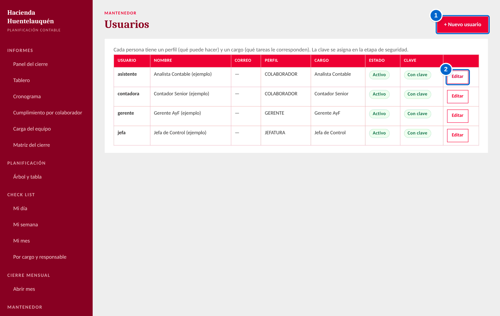{width=100%}

1. **+ Nuevo usuario**: crea una persona.
2. **Editar**: cambia nombre, correo, perfil, cargo o estado (activo/inactivo).

La tabla muestra el perfil, el cargo, si la cuenta está **activa** y si tiene **clave**.

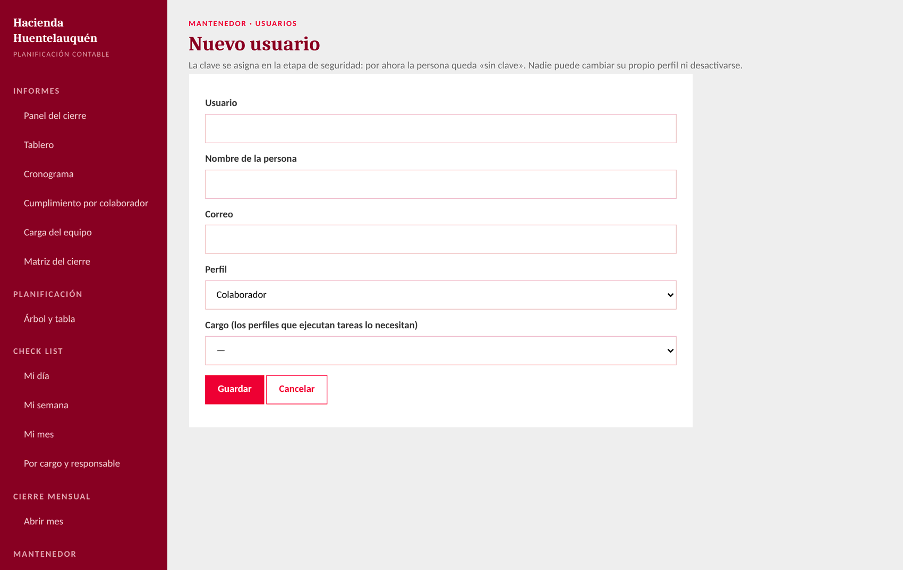{width=100%}

Para crear una persona completa: **Usuario** (el nombre con que ingresa), **Nombre de la persona**, **Correo**, **Perfil** (Gerente, Jefatura, Colaborador o Solo lectura) y **Cargo**. Los perfiles que ejecutan tareas necesitan un cargo.

> **Reglas de seguridad:** nadie puede cambiar su propio perfil ni desactivarse. Las **claves** de las cuentas reales las crea el administrador del sistema con una herramienta especial del servidor; nunca se envían por correo ni quedan escritas en archivos.

# 9. Preguntas frecuentes

**No veo una opción del menú (por ejemplo «Abrir mes» o «Usuarios»).** El menú depende del perfil. Si necesitas esa opción, pídele a la Gerente que revise tu perfil (sección 1.1).

**Marqué una tarea por error.** Avisa a quien la revisa: puede **devolverla** (queda «Devuelta») y tú la corriges y la marcas de nuevo. Una tarea marcada no se borra: el historial es permanente, para mantener el control.

**Una tarea me llegó pero no me corresponde.** Abre su detalle y usa **«Pasarla a otra persona»** (sección 6.5). Queda anotado.

**Estoy de vacaciones o ausente.** Avisa a tu jefatura y reasigna tus tareas a otra persona antes de irte. Cualquiera puede hacerlo mientras las tareas no estén hechas.

**¿Por qué mi cumplimiento baja si hice la tarea?** Porque la hiciste **después** de la fecha límite. El cumplimiento solo cuenta como a tiempo lo marcado en o antes de su vencimiento.

**¿Cómo agrego un comprobante?** En el detalle de la tarea, en «Agregar comentario», adjunta el archivo (PDF, imagen, Excel, Word, CSV o texto, hasta 10 MB).

**Me bloqueé por escribir mal la clave.** La cuenta se desbloquea sola a los 15 minutos. Si olvidaste la clave, pide al administrador que te asigne una nueva.

**Cambié de teléfono y no me deja entrar.** Pide al administrador que reinicie tu segundo factor (sección 2.2).

**¿Qué pasa con las tareas de un mes cerrado?** No se pueden modificar ni comentar. El mes cerrado queda como respaldo del trabajo hecho.

# 10. Qué no hace la aplicación

- **No se conecta a Odoo.** Las tareas se marcan a mano; la aplicación no lee ni escribe en el ERP.
- **No envía correos ni avisos** por sí sola. Hay que mirar «Mi día».
- **No reemplaza la revisión humana.** Registra quién revisó, pero no verifica el contenido contable.
- **Las horas son estimaciones.** Las horas reales las anota cada persona; no se miden solas.

# 11. Cómo pedir ayuda

Para cualquier duda de uso, contacta a la **Gerente de Administración y Finanzas**. Para problemas técnicos (no carga, no entra, se perdió el segundo factor), contacta al **administrador del sistema**.
